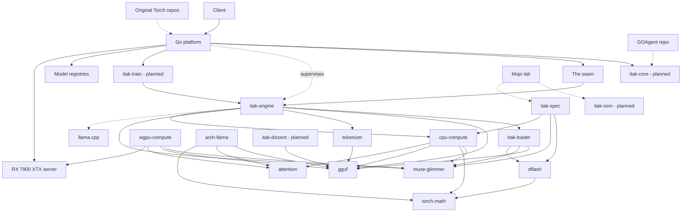

<!--
INSTRUCTIONS FOR THIS FILE (user and AI: read before editing. Keep this header.)

WHAT THIS FILE IS: the whole project laid out, at docs/MAP.md: every
module, page, screen, engine, and service, and every link between them
traced BOTH ways (what it points to, and what points back at it). It
exists so anyone can see the entire system at once and think about it
whole. A rendered visual version is generated from this file.

EXACT STRUCTURE:
- "## The grid": a table of every node: name, kind (page, screen,
  module, engine, service, external), what it owns.
- "## Links": a table of every connection: from, to, kind (navigates,
  calls, reads, writes, emits, hosts), and the backlink (the reverse
  relationship, named, or "none").
- "## Diagram": a Mermaid flowchart of the same nodes and links, kept
  in sync with the tables above it.
- "## Flows": the two or three main journeys through the system, in
  words, step by step.

RULES:
- Every node in the tables appears in the diagram and vice versa.
- When a module or link is added or removed, this file changes in the
  same commit.
- Facts only: the map shows what exists, with planned nodes marked
  (planned) so vision and reality never blur.
- No secrets, passwords, or tokens in this file, ever.
-->
# MAP: iTaK Torch Rebuild

Nodes marked (planned) are designed in PLAN.md and not yet built. Unmarked nodes exist today.

## The grid

| Node | Kind | Owns |
| :--- | :--- | :--- |
| Client | external | Sends OpenAI-compatible requests; owns nothing here. |
| Go platform | service | The front door, in platform/: cmd/torchd plus internal packages auth (API-key middleware), cache (TTL response cache with entry cap and janitor), chattemplate (GGUF template renderer with render budgets), diag (diagnostics registry), engine (socket client), scheduler (priority lanes with queue caps), server (HTTP routes and SSE), supervisor (engine lifecycle and restart budget). |
| The seam | module | The NDJSON-over-unix-socket protocol, defined once in crates/itak-engine/src/protocol.rs: six ops (hello, ping, debug, generate, embed, chat_template), streamed token frames, named errors. The socket is owner-only (0600) with hello enforcement and a peer uid check. Platform side: internal/engine (client) and internal/supervisor (process lifecycle). |
| itak-engine | service | The Rust engine binary: owns one loaded model on a worker thread and serves the seam protocol with generation slots and a bounded queue. Depends on gguf, tokenizer, itak-loader, muse-glimmer, and cpu-compute. |
| gguf | module | Strict GGUF v3 loader: header, metadata, tensor directory, and dequantization with fail-loud named errors. |
| tokenizer | module | Byte-level BPE and SentencePiece BPE over the model's own GGUF vocabulary, merges, and scores: encode, decode, round-trip, named errors on malformed input. |
| torch-math | module | Reference f32 math core: RMSNorm, RoPE, gated FFN activations, logit softcap and scale, matmul and matvec. Every constant (eps, RoPE base, softcap) is a parameter, never compiled in. |
| attention | module | The KV cache (global layers plus sliding-window ring layers) and grouped-query attention with causal and window masks. The advanced pools from PLAN (paged, INT8, compressed, offloaded, prefix sharing) are not built. |
| muse-glimmer | module | The Muse Glimmer architecture: config parsed from GGUF metadata, the measured weight layout (14 tensors per layer), and the structured forward for the 52-layer hybrid (39 sliding-window + 13 global). Compute and KV storage sit behind traits it owns. |
| arch-llama | module | Generic dense architecture for the llama and qwen2 families (pre-norm, RoPE, GQA with KV cache, SwiGLU), config and weights from the file's own GGUF metadata. Depends on gguf, attention, torch-math. |
| itak-loader | module | The loader bridge: implements the muse-glimmer module's Metadata and TensorSource traits over the gguf crate, and verifies a file's tensor inventory against the architecture's expected names (the coverage gate). |
| cpu-compute | module | The CPU reference Compute backend: real f32 arithmetic via torch-math, dequantization via gguf, KV storage via attention. This is the backend the serving engine runs today. |
| wgpu-compute | module | The wgpu (Vulkan) Compute backend: kernels K1 through K14 and the device-resident forward session. Proven against the golden as a bench (bench/gpu-resident-2026-10-30.md); not yet wired into the itak-engine binary. |
| dflash | module | The DFlash draft architecture: config from the draft file's own metadata, conditioning fused from named target layer inputs, non-causal block forward producing per-position draft logits. |
| itak-spec | module | The speculative decoding loop: DFlash block drafting against the target, exact-output verification, KV checkpoint and rewind, rejection sampling. Proven token-identical on CPU (bench/spec-loop-2026-10-30.md); not yet in the serving path. |
| itak-core (planned) | module | The shared Go contracts: types, health, event, debug, registry. Published and versioned. |
| itak-ssm (planned) | module | The state space scan: three-term recurrence, rotation on B and C, MIMO rank. |
| itak-moe (planned) | module | MoE routing, expert cache, expert streaming from disk. |
| itak-train (planned) | module | Training compute: autograd, optimizers, trainers, LoRA (Phase 7). |
| itak-dissect (planned) | tool | Weight statistics, measured heat maps, .itf conversion, quant planning (Phase 8). |
| Mojo lab | external | Existing Mojo engines and the Latent Engine research. Prototypes graduate into the crates. |
| Original Torch repos | external | iTaKTorchQ4 and itak-torch on GitHub: the reference implementation and feature specification. |
| GOAgent repo | external | Hosts the surviving pkg/debug and pkg/eventbus ancestors that itak-core ports from. |
| llama.cpp | external | The reference implementation to benchmark against. Never the product. |
| Model registries | external | HuggingFace and OCI: where model pulls come from. |
| RX 7900 XTX server | external | The home server and its 24 GB card: the hardware all performance claims are measured on. |

## Links

| From | To | Kind | Backlink |
| :--- | :--- | :--- | :--- |
| Client | Go platform | calls (HTTPS API) | Go platform returns responses and streams tokens to Client |
| Go platform | itak-core | reads (contracts, health, events) | itak-core is imported by Go platform |
| Go platform | The seam | writes (requests, control) | The seam returns tokens and engine health to Go platform |
| The seam | itak-engine | hosts (the connection both processes share) | itak-engine connects back through The seam |
| Go platform | itak-engine | hosts (supervision: start, restart within budget) | itak-engine reports lifecycle state to Go platform via /debug |
| itak-engine | gguf | calls (parse and dequantize) | gguf hands parsed files to itak-engine |
| itak-engine | tokenizer | calls (encode and decode) | tokenizer tokenizes for itak-engine |
| tokenizer | gguf | reads (vocabulary and merges from GGUF metadata) | gguf supplies the vocabulary the tokenizer builds from |
| itak-engine | itak-loader | calls (load model behind the coverage gate) | itak-loader loads models for itak-engine |
| itak-loader | gguf | reads (implements traits over the parsed file) | gguf is the file layer itak-loader bridges from |
| itak-loader | muse-glimmer | writes (implements its Metadata and TensorSource traits) | muse-glimmer receives its metadata and tensors through itak-loader |
| itak-loader | dflash | reads (draft file census and conditioning inputs) | dflash files are inventoried through itak-loader |
| itak-engine | muse-glimmer | calls (architecture forward) | muse-glimmer returns logits to itak-engine |
| itak-engine | cpu-compute | calls (Compute backend) | cpu-compute executes the forward for itak-engine |
| cpu-compute | muse-glimmer | reads (implements its Compute trait) | muse-glimmer runs on cpu-compute |
| cpu-compute | torch-math | calls (reference f32 arithmetic) | torch-math returns activations to cpu-compute |
| cpu-compute | gguf | calls (dequantization) | gguf dequantizes for cpu-compute |
| cpu-compute | attention | reads and writes (KV storage) | attention holds cache state for cpu-compute |
| wgpu-compute | muse-glimmer | reads (implements its Compute trait) | muse-glimmer can run on wgpu-compute (bench path today) |
| wgpu-compute | gguf | calls (dequantization and upload) | gguf supplies weights to wgpu-compute |
| wgpu-compute | attention | reads (KV shapes and masks) | attention defines the cache layout wgpu-compute mirrors on device |
| wgpu-compute | RX 7900 XTX server | runs on (Vulkan via wgpu) | RX 7900 XTX server hosts wgpu-compute |
| arch-llama | gguf | reads (metadata and tensors) | gguf supplies arch-llama |
| arch-llama | attention | reads and writes (KV cache) | attention holds cache state for arch-llama |
| arch-llama | torch-math | calls (reference f32 arithmetic) | torch-math returns activations to arch-llama |
| dflash | torch-math | calls (reference f32 arithmetic) | torch-math returns activations to dflash |
| itak-spec | dflash | calls (block drafting) | dflash drafts blocks for itak-spec |
| itak-spec | muse-glimmer | calls (target forward for verification) | muse-glimmer verifies drafts for itak-spec |
| itak-spec | cpu-compute | calls (Compute backend) | cpu-compute executes for itak-spec |
| itak-train | itak-engine | writes (trained heads, adapters) | itak-engine loads artifacts written by itak-train |
| Go platform | itak-train | calls (training API) | itak-train reports progress to Go platform |
| itak-dissect | gguf | writes (.itf files the loader reads) | gguf reads what itak-dissect writes |
| Go platform | Model registries | reads (model pulls) | Model registries serve pulls to Go platform |
| Mojo lab | itak-ssm | informs (algorithms graduate) | itak-ssm is where Mojo lab results land |
| Mojo lab | itak-spec | informs (drafting algorithms) | itak-spec is where Mojo lab results land |
| Original Torch repos | Go platform | informs (successor scope and audit record) | Go platform is the successor of Original Torch repos |
| GOAgent repo | itak-core | informs (debug and event ports) | itak-core descends from GOAgent repo |
| itak-engine | llama.cpp | compared against (benchmarks and goldens) | none |
| Go platform | RX 7900 XTX server | hosts on | RX 7900 XTX server hosts Go platform |

## Diagram

## Flows

1. **A chat request.** The client calls the Go platform. The platform authenticates, checks the request cache, applies its generation caps, and schedules the request. The request crosses the seam as a generate op; the engine tokenizes with the model's own tokenizer, loads weights through itak-loader behind the coverage gate, and runs the muse-glimmer forward on cpu-compute (torch-math arithmetic, attention crate KV). Token frames stream back over the socket and out to the client as SSE. Chat requests are rendered first by the platform's chattemplate package from the model's own GGUF template. Every refusal along the way emits through the diag channel with its reason.
2. **A speculative generation (bench path today).** The itak-spec runner loads the target and the DFlash draft through itak-loader. The draft proposes a block, conditioned on named target layer inputs; the target verifies the block in one forward; accepted tokens commit, the rest rewind the KV checkpoint, and rejection sampling corrects the distribution so the output stream is identical to plain greedy. Proven token-identical on CPU (bench/spec-loop-2026-10-30.md); wiring this loop into the serving engine is later work.
3. **A model arrives.** The platform pulls from HuggingFace or OCI, verifies integrity, and registers the version (model operations are platform scope; the pull path is still landing). At engine start, itak-loader parses the file through gguf and the coverage gate refuses the model by name if any expected tensor is missing, so a model that does not load completely never serves.
