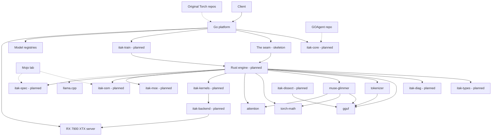

<!--
INSTRUCTIONS FOR THIS FILE (user and AI: read before editing. Keep this header.)

WHAT THIS FILE IS: the whole project laid out, at docs/MAP.md: every
module, page, screen, engine, and service, and every link between them
traced BOTH ways (what it points to, and what points back at it). It
exists so anyone can see the entire system at once and think about it
whole. A rendered visual version is generated from this file.

EXACT STRUCTURE:
- "## The grid": a table of every node: name, kind (page, screen,
  module, engine, service, external), what it owns.
- "## Links": a table of every connection: from, to, kind (navigates,
  calls, reads, writes, emits, hosts), and the backlink (the reverse
  relationship, named, or "none").
- "## Diagram": a Mermaid flowchart of the same nodes and links, kept
  in sync with the tables above it.
- "## Flows": the two or three main journeys through the system, in
  words, step by step.

RULES:
- Every node in the tables appears in the diagram and vice versa.
- When a module or link is added or removed, this file changes in the
  same commit.
- Facts only: the map shows what exists, with planned nodes marked
  (planned) so vision and reality never blur.
- No secrets, passwords, or tokens in this file, ever.
-->
# MAP: iTaK Torch Rebuild

Nodes marked (planned) are designed in PLAN.md and not yet built. Nodes marked (skeleton) exist in part. Unmarked nodes exist today.

## The grid

| Node | Kind | Owns |
| :--- | :--- | :--- |
| Client | external | Sends OpenAI-compatible requests; owns nothing here. |
| Go platform | service | The front door, at scaffold-plus stage in platform/: diag registry, API-key auth, TTL response cache, priority scheduler, engine client seam, HTTP server and the torchd daemon. Batching policy, cluster and tenancy, model operations, and training orchestration are still landing. |
| itak-core (planned) | module | The shared Go contracts: types, health, event, debug, registry. Published and versioned. |
| The seam (skeleton) | module | Control over a local socket; tokens and tensors over shared memory. The platform-side engine client with named errors and a unix socket skeleton exists; the shared-memory path and the Rust side are not built. Engine restart never takes the platform down. |
| Rust engine (planned) | service | The token loop process: owns generation end to end once a request crosses the seam. No engine binary crate exists yet; the five crates below are its standalone libraries, not yet wired together. |
| itak-types (planned) | module | Rust mirror of the shared contracts, with version fields. |
| itak-diag (planned) | module | Engine-side structured logs, health, events. |
| gguf | module | Strict GGUF v3 loader: header, metadata, tensor directory, and f32 dequantization with fail-loud named errors. PLAN.md and TODO.md call this module itak-loader; the built crate is named gguf, and the name reconciliation is open (see STATUS.md). |
| tokenizer | module | Real byte-level BPE over the model's own GGUF vocabulary: encode, decode, round-trip, named errors on malformed input. |
| torch-math | module | Reference f32 math core: matmul and matvec, RMSNorm, RoPE, logit softcap and scale, activations. Every constant (eps, RoPE base, softcap) is a parameter, never compiled in. |
| attention | module | The KV cache (global layers plus sliding-window ring layers) and grouped-query attention with causal and window masks. The advanced pools from PLAN (paged, INT8, compressed, offloaded, prefix sharing) are not yet built. |
| muse-glimmer | module | The Muse Glimmer architecture: config parsed from GGUF metadata, the measured weight layout (14 tensors per layer), and the structured forward for the 52-layer hybrid (39 sliding-window + 13 global). Skeleton stage: compute and KV storage sit behind traits it owns; no sibling crate is wired in yet. |
| itak-kernels (planned) | module | Production quantized matmul and dequant kernels that graduate from torch-math's reference implementations. |
| itak-ssm (planned) | module | The state space scan: three-term recurrence, rotation on B and C, MIMO rank. |
| itak-moe (planned) | module | MoE routing, expert cache, expert streaming from disk. |
| itak-spec (planned) | module | Speculative decoding: n-gram, Medusa, MTP, rejection sampling. |
| itak-backend (planned) | module | Backend trait: CPU SIMD, wgpu/Vulkan, others behind the seam. |
| itak-train (planned) | module | Training compute: autograd, optimizers, trainers, LoRA. |
| itak-dissect (planned) | tool | Weight statistics, measured heat maps, .itf conversion, quant planning. |
| Mojo lab | external | David's existing Mojo engines and the Latent Engine research. Prototypes graduate into the crates. |
| Original Torch repos | external | iTaKTorchQ4 and itak-torch on GitHub: the reference implementation and feature specification. |
| GOAgent repo | external | Hosts the surviving pkg/debug and pkg/eventbus ancestors that itak-core ports from. |
| llama.cpp | external | The reference implementation to benchmark against. Never the product. |
| Model registries | external | HuggingFace and OCI: where model pulls come from. |
| RX 7900 XTX server | external | The home server and its 24 GB card: the hardware all performance claims are measured on. |

## Links

| From | To | Kind | Backlink |
| :--- | :--- | :--- | :--- |
| Client | Go platform | calls (HTTPS API) | Go platform returns responses and streams tokens to Client |
| Go platform | itak-core | reads (contracts, health, events) | itak-core is imported by Go platform |
| Go platform | The seam | writes (requests, control) | The seam returns tokens and engine health to Go platform |
| The seam | Rust engine | hosts (the connection both processes share) | Rust engine connects back through The seam |
| Rust engine | itak-types | reads (contracts) | itak-types is imported by Rust engine |
| Rust engine | itak-diag | emits (logs, health, events) | itak-diag reports Rust engine state to the platform via The seam |
| Rust engine | gguf | calls (load model) | gguf hands weights to Rust engine |
| Rust engine | tokenizer | calls (encode and decode) | tokenizer tokenizes for Rust engine |
| tokenizer | gguf | reads (vocabulary from GGUF metadata) | gguf supplies the vocabulary the tokenizer builds from |
| Rust engine | muse-glimmer | calls (architecture forward) | muse-glimmer returns logits to Rust engine |
| muse-glimmer | gguf | reads (metadata and tensors via its TensorSource trait) | gguf is the trait's implementation target for muse-glimmer |
| muse-glimmer | torch-math | calls (compute trait; reference f32 implementations) | torch-math returns activations to muse-glimmer |
| muse-glimmer | attention | reads and writes (cache trait) | attention holds cache state for muse-glimmer |
| Rust engine | torch-math | calls (tensor math) | torch-math returns tensors to Rust engine |
| Rust engine | attention | reads and writes (cache state) | attention holds state for Rust engine |
| Rust engine | itak-kernels | calls (production kernels) | itak-kernels returns tensors to Rust engine |
| Rust engine | itak-ssm | calls (SSM layers) | itak-ssm returns layer outputs to Rust engine |
| Rust engine | itak-moe | calls (expert layers) | itak-moe returns layer outputs to Rust engine |
| Rust engine | itak-spec | calls (draft and verify) | itak-spec returns accepted tokens to Rust engine |
| itak-kernels | itak-backend | calls (device execution) | itak-backend executes for itak-kernels |
| itak-backend | RX 7900 XTX server | runs on (Vulkan via wgpu) | RX 7900 XTX server hosts itak-backend |
| itak-train | Rust engine | writes (trained heads, adapters) | Rust engine loads artifacts written by itak-train |
| Go platform | itak-train | calls (training API) | itak-train reports progress to Go platform |
| itak-dissect | gguf | writes (.itf files the loader reads) | gguf reads what itak-dissect writes |
| Go platform | Model registries | reads (model pulls) | Model registries serve pulls to Go platform |
| Mojo lab | itak-ssm | informs (algorithms graduate) | itak-ssm is where Mojo lab results land |
| Mojo lab | itak-spec | informs (n-gram and drafting algorithms) | itak-spec is where Mojo lab results land |
| Original Torch repos | Go platform | informs (code reattached module by module) | Go platform is the successor of Original Torch repos |
| GOAgent repo | itak-core | informs (debug and event ports) | itak-core descends from GOAgent repo |
| Rust engine | llama.cpp | compared against (benchmarks) | none |
| Go platform | RX 7900 XTX server | hosts on | RX 7900 XTX server hosts Go platform |

## Diagram

## Flows

1. **A chat request.** The client calls the Go platform. The platform authenticates, applies rate limits and token budgets, checks the request caches, and schedules the request. It crosses the seam: control over the socket, then the engine runs the token loop (gguf-supplied weights, tokenizer on the model's own vocabulary, torch-math reference kernels on the backend, attention crate KV or SSM state per layer, MoE experts streamed as needed, speculation drafting and verifying). Tokens return through shared memory and stream back to the client. Every refusal along the way emits through the diag channel with its reason.
2. **A training run.** The client calls the platform's training API. The platform validates and queues the job; itak-train runs it (SFT, LoRA, or a preference trainer; Medusa head training is a job type of its own). Artifacts land as versioned files. The engine picks them up by version: adapters serve, Medusa heads raise the speculative acceptance rate, and the eval harness measures the change.
3. **A model arrives.** The platform pulls from HuggingFace or OCI, verifies integrity, registers the version, and warms it. If the model is larger than VRAM, itak-moe serves it by streaming experts from disk with its pin and LRU cache fed by itak-dissect's measured heat data once the .itf conversion exists.
