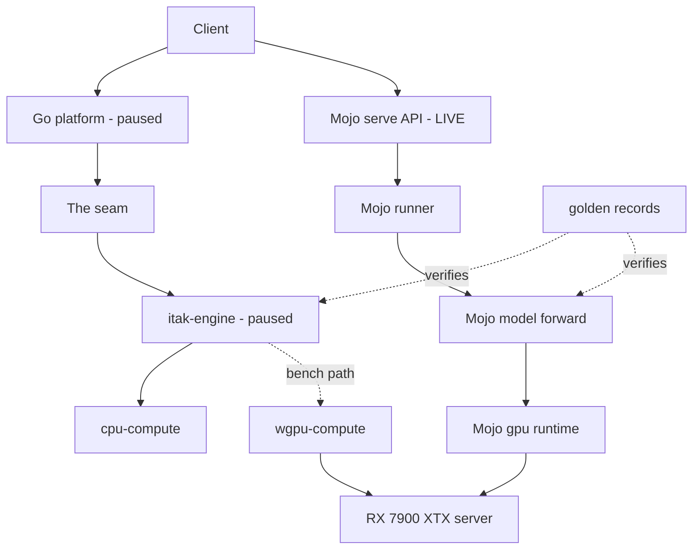

<!--
INSTRUCTIONS FOR THIS FILE (user and AI: read before editing. Keep this header.)

WHAT THIS FILE IS: the whole project laid out, at docs/MAP.md: every
module, page, screen, engine, and service, and every link between them
traced BOTH ways (what it points to, and what points back at it). It
exists so anyone can see the entire system at once and think about it
whole. A rendered visual version is generated from this file.

EXACT STRUCTURE:
- "## The grid": a table of every node: name, kind (page, screen,
  module, engine, service, external), what it owns.
- "## Links": a table of every connection: from, to, kind (navigates,
  calls, reads, writes, emits, hosts), and the backlink (the reverse
  relationship, named, or "none").
- "## Diagram": a Mermaid flowchart of the same nodes and links, kept
  in sync with the tables above it.
- "## Flows": the two or three main journeys through the system, in
  words, step by step.

RULES:
- Every node in the tables appears in the diagram and vice versa.
- When a module or link is added or removed, this file changes in the
  same commit.
- Facts only: the map shows what exists, with planned nodes marked
  (planned) so vision and reality never blur.
- No secrets, passwords, or tokens in this file, ever.
-->
# MAP: iTaK Torch Rebuild

The full relational diagram for this repo lives in
docs/relational-map/: INVENTORY.md (every node, its state, what it
owns, its source file), NODES.md and WIRES.md (the node and wire
tables), and DIAGRAM.md (the Mermaid diagrams). This page is the
short summary and the pointer. The detail lives there, not here.

State key: LIVE means code exists and does the job. LIVE, paused
means the line is paused by David's 2026-11-07 order and kept as
the parity scorekeeper. (planned) means a doc names it and no code
exists yet. The full map counts 72 nodes and 100 wires at the
2026-11-18 build (branch head b5522f2).

## The grid (summary by area)

| Area | Kind | Owns |
| :--- | :--- | :--- |
| Mojo engine (LIVE) | engine | The current engine, in mojo-engine/: GGUF loader, tokenizer, KV cache, attention, ops, GPU kernels, GPU runtime, the Glimmer forward (CPU and GPU), the generation loop with the greedy sampler, and the runner entry points. Version 1.07. |
| Mojo serve and test bench (LIVE) | service, page | The Mojo only in-process HTTP API (mojo-engine/src/serve/): chat completions, model fact sheets, run history with hash chained records, the leaderboard, the debug log feed, the MCP style bridge, the OpenAPI contract, and the dashboard page that builds itself from those feeds. |
| Rust workspace (LIVE, paused) | engine | The 13 crates in crates/: itak-engine (the serving binary), the seam protocol, gguf, tokenizer, torch-math, attention, muse-glimmer, arch-llama, itak-loader, cpu-compute, wgpu-compute, dflash, itak-kv, itak-spec. |
| Go platform (LIVE, paused) | service | The front door, in platform/: cmd/torchd plus internal packages auth, cache, chattemplate, diag, engine (socket client), scheduler, server (HTTP routes and SSE), supervisor (engine lifecycle). |
| Support records (LIVE) | records | bench/ (101 dated notes; every speed claim ties to one), golden/ (the golden token records both lines are checked against), and the planning docs (PLAN.md, TODO.md, mojo-engine/DESIGN.md). |
| Planned work (planned) | modules | Wave F1-B striping and fusions, Wave F2 WMMA prefill, the full sampler family, the Qwen3.5 port, the vision generation path, streaming chat, the Mojo speculative wave, itak-core, itak-types, itak-ssm, itak-moe, itak-train, itak-dissect, advanced KV tiers, more backends, and the Go platform Phase 6 expansion. Each one is a named node in docs/relational-map/. |
| External | external | The client, the RX 7900 XTX server, the model files, the model registries, llama.cpp (the reference both engines are benchmarked against), the original Torch repos, and the GOAgent repo. |

Two absences the full map names plainly: there is no CI in this
tree yet, and the Go platform has no database (all of its state is
in memory).

## Links (summary)

The full wire table (100 wires, each with its backlink) is
docs/relational-map/WIRES.md. The load bearing wires:

- Client calls both front doors: the Go platform (paused line) and
  the Mojo serve API (live line).
- Go platform reaches the Rust engine only through the seam: NDJSON
  over a unix socket, with the supervisor owning the engine process.
- The Rust engine binary runs on cpu-compute only. wgpu-compute,
  itak-spec, and itak-kv hang off the bench and session paths, not
  the serving binary. The Cargo manifests say so.
- The Mojo runner drives the model through the ForwardModel trait;
  the serve loop and the CLI runner share the same generation loop,
  tokenizer, and loader.
- Both engine lines read the same model files and are verified
  against the same golden records, and both are benchmarked against
  llama.cpp on the same card.

## Diagram

The per-area diagrams are in docs/relational-map/DIAGRAM.md. This
overview matches them.

## Flows

1. **A chat request on the live (Mojo) line.** The client calls the
   serve API inside the Mojo engine process. The request is checked
   against the serve limits in config (greedy only today; anything
   else is refused by name), the prompt is tokenized with the
   model's own tokenizer, and the generation loop runs the Glimmer
   forward on the GPU runtime. The reply carries the run's speed
   and token counts, and the run is written to the hash chained
   history that the dashboard and leaderboard read.
2. **A chat request on the paused (Rust and Go) line.** The client
   calls the Go platform. The platform authenticates, checks the
   response cache, renders the chat template from the model's own
   GGUF template, and schedules the request. The request crosses
   the seam as a generate op; the Rust engine tokenizes, loads
   weights through itak-loader behind the coverage gate, and runs
   the muse-glimmer forward on cpu-compute. Token frames stream
   back over the socket and out to the client as SSE.
3. **A model arrives.** At engine start, each line's loader parses
   the GGUF file and refuses the model by name if any expected
   tensor is missing, so a model that does not load completely
   never serves. The Mojo fact sheets describe a file (family,
   layer split, vision proof) even for a family whose generation
   has not landed yet; the Qwen3.5 vision file is the standing
   example, and its images are refused by name until the vision
   path is built.
