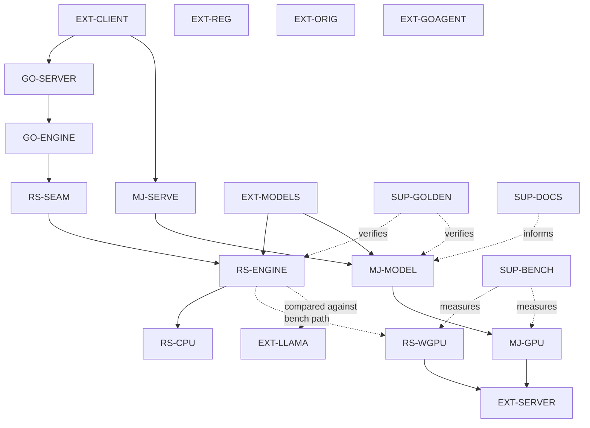
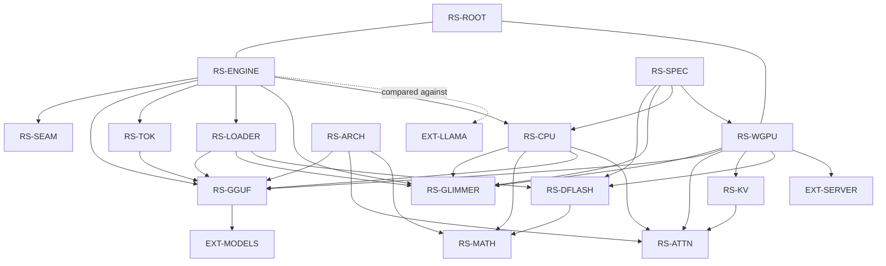
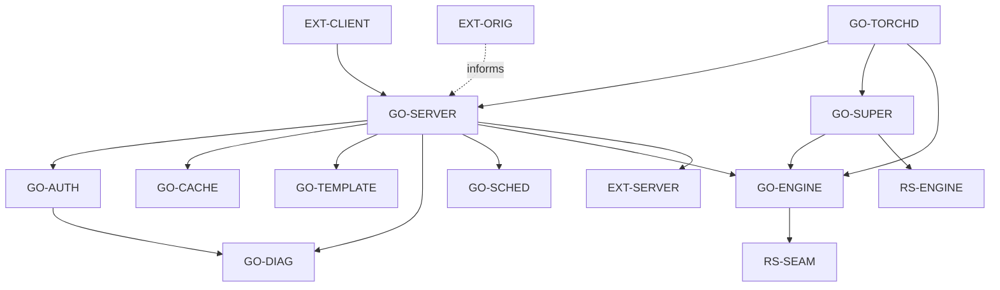
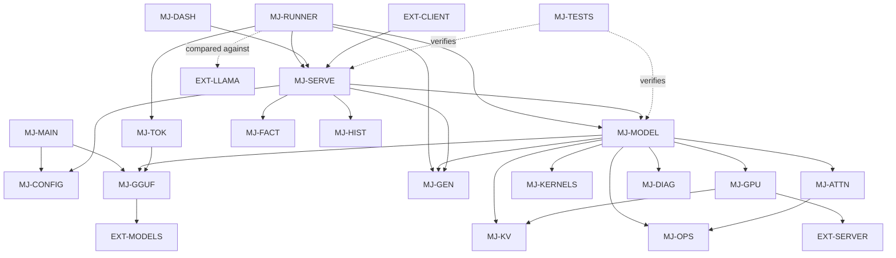

# Relational map: diagrams

Mermaid diagrams of the same nodes and wires as NODES.md and
WIRES.md. One overview, then one diagram per area: the Rust
workspace, the Go platform, the Mojo engine, and the planned and
absent set. Every node in the tables appears in at least one
diagram here. Dashed arrows are planned, absent, or comparison
wires, matching WIRES.md.

Built from the code at branch head b5522f2 (mojo-max-engine),
2026-11-18.

## Overview

The shape of the whole project in one picture: two engine lines
(the paused Rust line behind the Go platform, and the live Mojo
line with its own serve API), the support records both lines are
judged against, and the hardware everything is measured on.

## Rust workspace (paused line)

## Go platform (paused line)

## Mojo engine (live line)

## Planned and absent

```mermaid
flowchart TD
  MJKERNELS2[MJ-KERNELS] -. PLANNED .-> PLF1B[PL-F1B]
  MJMODEL2[MJ-MODEL] -. PLANNED .-> PLF1B
  MJKERNELS2 -. PLANNED .-> PLF2[PL-F2]
  MJGEN2[MJ-GEN] -. PLANNED .-> PLSAMPLER[PL-SAMPLER]
  MJMODEL2 -. PLANNED .-> PLQWEN[PL-QWEN]
  MJSERVE2[MJ-SERVE] -. PLANNED refusal today .-> PLVISION[PL-VISION]
  MJSERVE2 -. PLANNED .-> PLSTREAM[PL-STREAM]
  MJGEN2 -. PLANNED .-> PLSPEC[PL-SPEC]
  GOSERVER2[GO-SERVER] -. PLANNED .-> PLCORE[PL-CORE]
  EXTGOAGENT2[EXT-GOAGENT] -. PLANNED .-> PLCORE
  PLTYPES[PL-TYPES]
  PLSSM[PL-SSM]
  PLMOE[PL-MOE]
  PLTRAIN[PL-TRAIN] -. PLANNED .-> RSENGINE3[RS-ENGINE]
  GOSERVER2 -. PLANNED .-> PLTRAIN
  PLDISSECT[PL-DISSECT] -. PLANNED .-> RSGGUF2[RS-GGUF]
  RSATTN2[RS-ATTN] -. PLANNED .-> PLKVT[PL-KVT]
  RSWGPU2[RS-WGPU] -. PLANNED .-> PLBACKENDS[PL-BACKENDS]
  GOSERVER2 -. PLANNED .-> PLGOPHASE6[PL-GOPHASE6]
  GOSERVER2 -. PLANNED pulls .-> EXTREG2[EXT-REG]
  GOENGINE2[GO-ENGINE] -. ABSENT .-> ABSHMEM[AB-SHMEM]
  SUPDOCS2[SUP-DOCS] -. ABSENT target .-> ABCI[AB-CI]
  SUPDOCS2 -. ABSENT target .-> ABFUZZ[AB-FUZZ]
  GOSERVER2 -. ABSENT .-> ABDB[AB-DB]
```

